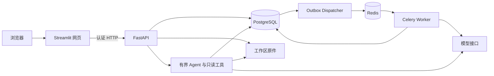

# CustomerInsight — 顾客评价分析与问答平台

把顾客评价表变成可追问、可追溯的经营报告：上传 Excel / CSV，查看情感、问题类别、优先级和具体主题，点击图表核对原文，再向 Agent 连续追问。

项目基于 [AI Customer Feedback Analyzer](https://github.com/ysskrishna/ai-customer-feedback-analyzer) 二次开发，扩展了账户隔离、后台任务、历史批次比较和原表查询，支持自行部署并使用自己的模型接口。

[30 秒演示视频](media/CustomerInsight_demo_30s.mp4) · [演示操作](docs/DEMO_UPGRADE.md) · [后端技术栈](docs/BACKEND_STACK.md) · [账户版部署](docs/API_PHASE4.md)

## 先体验完整流程

打开网页点击“体验完整示例”；账户部署中也可以在登录页点击“先体验完整示例”。

1. 查看两批各 30 条中文合成评价的总结、主题和图表。
2. 点击图表或“查看相关评价”，核对原始评价与行号。
3. 在“问 Agent”中依次点击“回放第一轮”和“继续回放第二轮”。
4. 将回答“加入经营简报”，在“明细与下载”导出包含图表与原文依据的 HTML。

示例标签与两轮回答为明确标注的离线预置回放。打开示例、筛选、回放和下载不会调用模型，也不会读取私人账户历史。

要自由提问，登录后点击“保存示例并进入实时问答”，再单独同意发送数据并提交问题。导入示例不调用模型；实时问答会使用部署者配置的接口。

## 用户能做什么

| 功能 | 使用效果 |
| --- | --- |
| Excel / CSV 分析 | 选择工作表与评价列，可按商品、门店等已有列分组；保留空值、重复与失败状态 |
| 图表与主题 | 查看情感、主类别、优先级、差评和具体主题，点击后定位相关原文 |
| 多轮 Agent | 结合报告和有限对话背景回答，必要时查询当前原表或明确选定的历史批次 |
| 历史批次比较 | 对比覆盖率、基础分类和兼容主题；主题口径不兼容时仍可比较基础分类 |
| 结果导出 | 下载明细、报告、对话，以及包含所选回答、图表和依据的离线经营简报 |
| 账户与后台任务 | 账户部署按工作区隔离数据；关闭页面后分析任务继续，可重新登录查看结果 |

多条短评会分组合并为一次模型请求，实际请求数取决于文本长度、重复项和任务状态。统计数量与比例由程序计算，结构化标签、摘要和 Agent 正文由模型生成。

## 本机快速启动

使用 Python 3.12 或 3.13。以下为 Windows PowerShell 示例：

```powershell
git clone https://github.com/ItookapillinGZ/CustomerInsight.git
cd CustomerInsight
python -m venv .venv
.\.venv\Scripts\python.exe -m pip install -r requirements.txt
if (!(Test-Path -LiteralPath .env)) { Copy-Item -LiteralPath .env.example -Destination .env }
.\.venv\Scripts\python.exe -m streamlit run app.py --server.address 127.0.0.1 --server.port 8501
```

打开 <http://localhost:8501>。已有环境也可使用 `start-local.cmd`；它会检查 Python 版本、安装依赖并启动网页。首次创建的 `.env` 是配置模板，需要自行填写后重新启动。

分析自己的表格前，在 `.env` 配置 `OPENAI_API_KEY`、`OPENAI_MODEL`，兼容服务还需正确填写 `OPENAI_BASE_URL`。不要覆盖已有 `.env`。示例回放不需要真实模型调用。

本机简易模式也可以通过 Docker 启动：

```sh
docker compose up -d --build
```

这两种简易入口使用共享本地工作区，所选工作表最多 100 行。详见 [简易部署说明](SELF_HOSTING.md)。

## 账户与后台任务部署

需要多账户、持久化任务与后台 Worker 时，使用独立的 `compose.production.yml`。完整首次部署、创建账户、升级与备份步骤见 [账户版部署说明](docs/API_PHASE4.md)。

- 部署包含网页、FastAPI、Celery Worker、Outbox Dispatcher、PostgreSQL、Redis 和独立数据库迁移任务。
- 网页通过认证 HTTP 使用后端，不挂载业务数据卷，也不持有模型或数据库密钥。
- 账户由部署者创建；网页登录表单不会自动注册新账户。
- 所选工作表最多支持 1,000 行，不会自动分析工作簿中的其他工作表。
- 上传原件、报告、任务和对话按服务端验证的工作区限定。
- 默认仅绑定本机端口；对外开放前需按实际部署配置访问控制与 HTTPS。

升级时保留 `.env`、Compose 项目名和数据卷。已有共享历史需要显式指定归属账户迁移，不能直接作为全部账户的共同数据。

## Python 后端架构



| 技术 | 实际职责 |
| --- | --- |
| FastAPI / Uvicorn / Pydantic | HTTP 服务、认证入口、上传与参数校验、任务进度、报告和 Agent 接口 |
| PostgreSQL / SQLAlchemy / Alembic | 账户、工作区、任务、报告和对话持久化，事务与数据库迁移 |
| Celery / Redis / Lua | 后台分析、消息投递、共享并发租约和服务心跳 |
| Pandas / openpyxl / NumPy | 表格读取、字段校验、原始行追溯、确定性统计与导出 |
| OpenAI 兼容 SDK / HTTPX | 模型调用，以及网页与后端的 HTTP 通信 |
| Argon2id / 不透明会话 | 密码哈希、会话过期与撤销、工作区隔离 |
| SQLite / 文件系统 | 部署级每日请求额度，以及工作区原件与持久化数据卷 |
| Streamlit / Altair | 上传、报告、对话、交互图表和下载界面 |
| Docker Compose / unittest / GitHub Actions | 环境部署、离线回归、依赖检查和持续检查配置 |

任务通过 Outbox、幂等键、租约和逐组检查点处理重复通知与中断。无法确认模型是否已经处理的付费请求进入待核对状态，不自动重复发送。

Agent 每轮有模型请求与工具次数上限，工具限定查询授权报告、字段、原始行和所选历史批次，不执行任意代码或 SQL。数字、分母与原始行引用由程序核对，不能据此保证自然语言解释或建议必然正确。

更多实现与边界见 [后端技术栈](docs/BACKEND_STACK.md)。

## 离线测试

安装依赖后运行，不需要真实 API Key；模型请求由 Mock 替代，集成测试缺少专用环境时会跳过：

```sh
python -m unittest discover -s tests -v
```

Windows 未激活虚拟环境时，可用 `.\.venv\Scripts\python.exe` 替换 `python`。真实 PostgreSQL、Redis、Celery 与备份恢复验收需要独立测试环境；不要把业务数据库配置为测试目标。

GitHub Actions 工作流位于 [.github/workflows/ci.yml](.github/workflows/ci.yml)，包括离线回归、隔离数据库与队列集成检查、镜像构建及备份恢复验证。具体执行结果以仓库 Actions 记录为准。

## 示例、文档与代码

| 入口 | 内容 |
| --- | --- |
| [examples/](examples/) | 评价表模板和流程示例 |
| [core/demo_data/](core/demo_data/) | 两批合成评价与离线回放的权威示例数据 |
| [演示说明](docs/DEMO_UPGRADE.md) | 图表联动、两轮回放、简报导出和验证边界 |
| [API 第一阶段](docs/API_PHASE1.md) | HTTP API 入口与契约 |
| [任务服务](docs/API_PHASE2.md) | 队列、任务状态、幂等与恢复 |
| [账户与迁移](docs/API_PHASE3.md) | 账户工作区、会话与历史迁移 |
| [部署与运维](docs/API_PHASE4.md) | 独立页面、就绪检查、备份恢复和账户部署 |
| [ai/](ai/)、[core/](core/)、[backend/](backend/) | 模型适配、报告与 Agent、后端服务 |
| [tests/](tests/) | 模型、表格、任务、权限、接口与页面测试 |

## 使用边界

- 当前是单机自部署架构，不包含多节点高可用、对象存储或按账户计费。
- 支持普通 `.xlsx` / `.csv`；旧 `.xls` 请先另存为 `.xlsx`。
- 真实分析和实时问答会把必要数据发送至部署者配置的模型服务，并产生接口费用。上传前去除无关个人信息。
- 示例为合成数据；离线回放和 Mock 调度验证只说明工程流程，不代表真实模型效果或业务准确率。
- 历史合成标签实验衡量参考标签一致性；不同业务、语言和模型需要独立抽样复核。新增图表规格的供应商兼容性尚待真实验收。
- 主题归一保留原主题与证据；主题版本不兼容时不计算主题增减，缺少日期时不把导入批次当作时间趋势。
- `.env`、账户凭据、数据卷、私人原表和备份应私密保存，不提交到仓库。

## 来源与许可证

原项目：[AI Customer Feedback Analyzer](https://github.com/ysskrishna/ai-customer-feedback-analyzer)。原作者：**Y. Siva Sai Krishna**（[@ysskrishna](https://github.com/ysskrishna)）。

保留 [MIT License](LICENSE) 与 **Copyright (c) 2025 Y. Siva Sai Krishna**。本项目的扩展不改变原许可；代码许可不替代独立公开数据集各自的许可。原 `media` 图片不作为新增功能截图。
