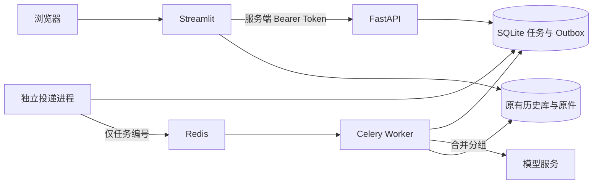

# 阶段二：后台分析任务

## 使用方式

保留已有 `.env` 和 Docker 数据卷。首次配置 API Token 可运行 `python tools/prepare_api_access.py`，该工具只填入空白 Token，不输出密钥、不覆盖模型配置。

```powershell
docker compose -f compose.yml -f compose.api.yml -f compose.jobs.yml up -d --build
```

浏览器打开 <http://localhost:8501>，上传表格、选工作表和评价列、同意发送评价后点击分析。网页获得任务编号，显示逐组进度；关掉网页不影响后台运行。新浏览器可从“后台分析任务”重新打开任务，完成后打开报告。页面中断不代表取消；停止需要点击取消。查看进度、重新打开报告不发送模型请求。

队列模式支持单张工作表最多 **1,000 行、5 MB**；一次仍只处理所选工作表，不会自动遍历其他表。默认最多 10 条不同短评合并一组，长文会缩小分组。任务保存总请求上限，实际每天仍受原 `APP_DAILY_REQUEST_LIMIT` 限制；例如 500 条短评预计约 50 次请求，但今天剩余额度可能更少。页面恢复或剩余额度不足不会自动增加任务预算。相同文件的已保存报告可直接复用。

本地 `streamlit run app.py` 默认仍为 `direct`，沿用 100 行限制。选择 `queued` 必须同时启动 API、Redis、Worker 和投递器；API 不可用时不会退回同步付费分析。Compose 自动注入队列配置，不必改实际 `.env` 的原模型设置。`compose.jobs.yml` 应始终与前两个文件合用，避免切换部署时遗漏队列配置。

## 运行结构



上传、分析提交与任务控制使用 HTTP API；旧报告展示、历史管理和 Agent 仍复用本地业务服务。页面尚未全面改为无状态 API 客户端。API、Worker、页面共享 `/data`，模型请求共享 SQLite 每日额度和 Redis 并发令牌，Token 保留在页面服务器，不发到浏览器。Redis 不映射宿主端口。

当前为一个可信工作区、一个 Worker、一个执行子进程，SQLite 负责事务。共享 Bearer Token 不是账户或租户隔离。PostgreSQL、SQLAlchemy、Alembic、多用户授权及多节点扩展安排在下一阶段；本阶段不宣称已经支持多租户生产服务。

## HTTP 契约

所有 `/api/v1/` 接口都需要 `Authorization: Bearer <APP_API_TOKEN>`；具体模型见 <http://localhost:8000/docs>。

| 请求 | 作用 |
| --- | --- |
| `POST /uploads`，multipart `purpose=job`、`encoding` | 校验并暂存文件，允许队列行数上限；CSV 编码须与预览、提交一致 |
| `GET /uploads/{id}/preview` | 预览指定工作表与字段，不调用模型 |
| `POST /jobs` | 原件、字段映射、规则、分组、初始行和 Outbox 原子持久化，返回任务 |
| `GET /jobs?limit=20&offset=0` | 分页查看持久任务，重新打开页面后仍可读取 |
| `GET /jobs/{id}` | 查询进度、请求计数、可恢复状态和报告编号 |
| `POST /jobs/{id}/cancel` | 停止领取新分组；正在发送的分组仍可能完成并计费 |
| `POST /jobs/{id}/resume` | 明确授权及总请求预算后恢复安全的未发送分组 |
| `GET /batches/{batch_id}` 及 `/rows`、`/exports/*` | 复用阶段一接口读取结果、分页明细及下载 |

创建请求示例（示例 ID 需替换成预览返回的值）：

```json
{
  "upload_id": "0123456789abcdef0123456789abcdef",
  "text_column": "评价内容",
  "sheet_name": "Sheet1",
  "allow_model_call": true,
  "max_requests": 50,
  "idempotency_key": "client-generated-unique-key"
}
```

新任务返回 `202`、`Location` 和任务 ID。已有报告命中可在 `allow_model_call=false` 时返回 `200`、`cached=true`、`id=null` 和 `batch_id`，不创建作业。幂等键在提交前由客户端生成，响应丢失时保留同一键，不能生成新键盲目重试；同键不同内容返回冲突。原件与分析配置相同的活动任务还会做业务去重。明确再次分析才设置 `force=true`。队列部署中的旧 `POST /analyses` 返回 `409`，避免绕过任务工作流。

公开任务响应只包含状态与计数，不包含任务内部原件、原文分组或模型配置。Redis 消息只包含任务编号，Celery 返回日志也只含编号、状态和请求数。

## 保存、恢复与费用边界

`APP_DATA_DIR/analysis_jobs.sqlite3` 独立保存任务、原件 BLOB、表格快照、分组、结果、请求尝试与 Outbox；原上传临时文件到期不影响已接受任务。每组完成后立刻校验并提交结果。报告仍进入原来的 `customerinsight.sqlite3`，不迁移或改写旧报告格式。

Worker 用事务领取分组，使用租约、心跳和 fencing token 拒绝过期执行者。消息可能重复送达，领取与结果提交要查数据库，而不是依赖 Celery task ID 去重。旧一代任务的迟到报告也不能覆盖同原件与映射的新一代报告。

| 中断位置 | 行为 |
| --- | --- |
| 数据库已接受但 Redis 未投递 | Outbox 保留，独立投递器每 5 秒检查恢复 |
| 已领取、尚未预留发送，租约过期 | 分组可重新领取，不占新模型请求 |
| 已标记发送但响应未知，例如连接中断、超时、进程被杀 | 标记 `needs_review`，保留占用，不自动重发，也不提供直接恢复按钮 |
| 已有响应但结构校验失败 | 保存已报告 usage 和失败结果，不自动重试该组 |
| 每日额度不足、执行配置改变 | 保存当前进度，明确恢复后才继续未发送部分 |
| 用户取消 | 保留已有与当前在途结果；恢复需要再次确认预算 |

HTTP 超时不能证明模型服务没有收到请求。以上机制限制重复付费风险，但不能保证上游绝对只收费一次。每日额度先预留、任务发送台账后提交，分属两个数据库；二者之间崩溃可能保守地占用每日次数而没有真实发送，不能因此自动返还额度。预算是请求次数，不是金额。

已执行分组不自动重算；`needs_review` 不能简单点击“重试全部”。需要部署者核对任务台账及模型服务账单，明确重新分析才可另建任务。

## 部署与运维边界

```powershell
# 只查看服务状态，不打印环境变量
docker compose -f compose.yml -f compose.api.yml -f compose.jobs.yml ps
# 独立投递器入口（Compose 已运行它）
python -m backend.dispatch
# 离线回归
python -m unittest discover -s tests -v
# 真实 Redis/Celery、模拟模型的隔离验收
python tools/verify_job_queue.py --image customerinsight-backend:phase2
```

Worker 不使用镜像的 Streamlit 健康检查。现有 HTTP 健康接口仅证明 API/UI 进程可访问，不证明 Worker、队列或模型可用；完整就绪指标属于下一阶段。Redis 暂时不可用时提交仍可持久保存，但不能启动新的模型请求。

网页任务区目前显示最近 20 个任务，更早的任务可通过 API 分页查询；已保存报告仍从历史报告打开。

历史页面的 ZIP 备份包含原表、报告与对话，**不包括后台任务库和额度台账**。完整备份需停止这套服务后复制整个 `/data` 卷（包含 SQLite 的相关文件）；保留 Redis 卷或由 SQLite Outbox 恢复消息。不要只复制一个正在写入的 SQLite 文件。后台任务目前没有自动清理策略，也不提供单任务删除接口；有任务引用的历史报告会禁止从页面删除，避免残留原件与失效任务链接。存储容量、保留期、原子全工作区备份及恢复工具仍需后续完善。

本阶段实现依据包括 [Celery 的迟确认及 Worker 丢失说明](https://docs.celeryq.dev/en/stable/userguide/configuration.html#task-acks-late) 和 [Redis Broker 的可见性超时说明](https://docs.celeryq.dev/en/v5.6.2/getting-started/backends-and-brokers/redis.html#visibility-timeout)。队列重投不会替代业务持久化与上游费用边界检查。
