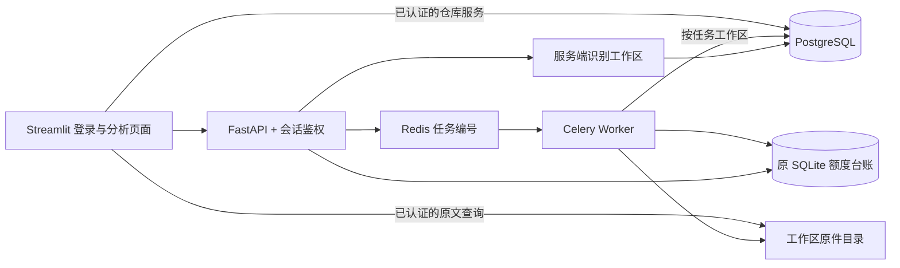

# 阶段三：PostgreSQL 与账户工作区

本文保留阶段三的架构和迁移证据。当前推荐部署、页面 HTTP 边界和完整备份恢复见 [阶段四说明](API_PHASE4.md)；阶段四已完成下文当时尚未迁移的 UI 接口工作。

## 用户使用

打开 <http://localhost:8501>，先登录，再上传表格、选择评价列、点击分析。每个账户有独立工作区：原件、上传预览、分析任务、报告、字段映射和对话只在所属工作区可见。关闭浏览器不取消后台任务。登录会话保存在 Streamlit 服务器当前会话中，不把部署者的共享 API Token 传到浏览器；关闭后重新连接可能需要重新登录。

当前部署者账户名为 `owner`。初始随机密码由部署工具保存于数据卷 `/data/customerinsight/.bootstrap/owner.json`，本机副本在 `.runtime/phase3/owner_credentials.json`。不要把凭据文件放进源码包。登录后可在侧栏修改密码；必须验证当前密码，修改成功会撤销该用户全部会话并退出。改密后初始凭据文件不会自动更新，其中的旧密码将失效。

账户由部署者创建，没有公开注册、团队邀请或多角色管理。当前一名用户对应一个工作区。新账户不会获得旧共享历史；旧 SQLite 数据必须明确指定归属账户导入。本机旧报告归入 `owner`，其他账户初始为空。

## 架构和持久化



PostgreSQL 使用 SQLAlchemy 2.x 声明式模型及 Core 事务，Alembic 管理显式版本迁移。表包括工作区、用户、会话、登录限流、历史批次、字段映射，以及任务、分组、逐行结果、请求尝试、幂等键和 Outbox。报告和逐行结构化结果仍保留已有校验序列化，避免破坏旧版本的来源与引用。没有在请求启动时自动 `create_all`。

原文件保存在 `APP_DATA_DIR/workspaces/<服务端工作区ID>/originals/`。上传暂存也在工作区内，未认证请求不能先上传再补鉴权。请求正文或查询参数不能选择服务端文件路径或其他工作区。历史去重按工作区、原文件摘要与映射隔离；任务幂等和代际导出保护同样带工作区边界。

Redis 消息仍只包含任务 ID。Worker 是受信后台组件，先从 PostgreSQL 读取任务所属工作区，再构造有范围的任务和历史仓库，不能把后台全局仓库用于外部 HTTP。PostgreSQL 任务事务锁保留阶段二的租约、fencing、未知发送隔离和 Outbox 语义；没有宣称上游仅收费一次。

为保留已有调用占用，**全局每日请求额度仍使用原 SQLite 台账**，API、Worker 和 Agent 共用它；Redis 并发闸门继续生效。它是部署者的全局上限，不是按账户收费系统。该实现仍按单机、共享数据卷部署；原件、本地额度与任务写事务锁尚不支持多节点扩容，不把数据库升级解释为已完成分布式生产验收。

## 鉴权与权限

密码使用 Argon2id 哈希。登录返回高熵不透明 Bearer Token，数据库只保存 Token 摘要，默认 8 小时过期。每次请求校验用户有效、会话未撤销且未到期；注销、改密后立即失效，不使用永久共享 Token 作为用户身份。账户模式完全拒绝旧 `APP_API_TOKEN` 读取业务数据。

登录按用户名及实际连接 IP 共同限速，状态存数据库，多 API 进程共享；不信任任意客户端提供的 `X-Forwarded-For`。Streamlit 的登录请求来自页面服务器，同一来源会共享 IP 窗口，这是小规模自部署的保守限制。外网使用 HTTPS；当前 Compose 默认只暴露本机 UI/API 端口，PostgreSQL 和 Redis 不映射宿主端口。

接口清单见 <http://localhost:8000/docs>：

| 接口 | 行为 |
| --- | --- |
| `POST /api/v1/auth/login` | 唯一公开账户入口，用户名/密码验证及限速 |
| `GET /api/v1/auth/me` | 当前用户与服务端工作区，不返回密码或会话摘要 |
| `POST /api/v1/auth/logout` | 撤销当前会话，返回 204 |
| `POST /api/v1/auth/password` | 校验旧密码，更新密码并撤销全部会话 |
| 原上传、任务、报告、下载及 Agent 接口 | 使用用户会话，所有 ID 都在当前工作区查询；其他人的 ID 返回 404 |

列表、预览、原件、CSV/HTML 导出、聊天历史、Agent 比较和原文检索均应用同一范围。猜测 UUID 不能获得权限。原 UI 的历史读取、备份、删除、比较和 Agent 仍在服务器调用仓库服务，每次由已验证会话确定工作区，尚未全部改成 HTTP 客户端；这是后续接口迁移工作，不能视为权限豁免。退出登录会清除该服务器会话的原表、报告、对话及控件状态。

聊天新增使用事务追加，避免两个 API 进程相互覆盖消息；报告重分析和聊天保存持工作区锁并重新检查引用。旧 SQLite 模式仍保持兼容，但与账户模式是独立部署选择，不会双写同步。

## 新部署与旧数据迁移

保留已有 `.env`。准备新的 PostgreSQL 密码只增加缺少的配置，不修改原模型接口：

```powershell
python tools/prepare_account_deployment.py
docker compose -f compose.yml -f compose.api.yml -f compose.jobs.yml -f compose.accounts.yml build api
docker compose -f compose.yml -f compose.api.yml -f compose.jobs.yml -f compose.accounts.yml up -d postgres
docker compose -f compose.yml -f compose.api.yml -f compose.jobs.yml -f compose.accounts.yml run --rm --no-deps db-init
docker compose -f compose.yml -f compose.api.yml -f compose.jobs.yml -f compose.accounts.yml run --rm --no-deps api python -m backend.manage bootstrap --username owner --credentials-file /data/customerinsight/.bootstrap/owner.json
```

首次没有旧历史时，直接执行下方最后的启动命令。已有阶段二数据时，先备份，停止旧 UI/API/Worker/投递器，防止迁移期间还在写入，再显式核对和导入：

```powershell
docker compose -f compose.yml -f compose.api.yml -f compose.jobs.yml stop customerinsight api worker dispatcher
docker compose -f compose.yml -f compose.api.yml -f compose.jobs.yml -f compose.accounts.yml run --rm --no-deps api python -m backend.manage import-legacy --source /data/customerinsight --owner owner --verify-only
docker compose -f compose.yml -f compose.api.yml -f compose.jobs.yml -f compose.accounts.yml run --rm --no-deps api python -m backend.manage import-legacy --source /data/customerinsight --owner owner
docker compose -f compose.yml -f compose.api.yml -f compose.jobs.yml -f compose.accounts.yml up -d --no-build
```

导入只读旧 SQLite，保留批次 ID、原始时间、报告/聊天序列化及其摘要，原件逐一核对后复制到明确账户的目录。相同内容再次导入跳过；冲突会中止，不覆盖目标。旧数据库及原件不删除。如果旧任务库非空，工具拒绝切换：当前导入器只处理历史，不会悄悄丢弃任务台账或重新发送模型请求。此时应保留阶段二部署，另行实施任务迁移方案。

创建其他账户：

```powershell
docker compose -f compose.yml -f compose.api.yml -f compose.jobs.yml -f compose.accounts.yml exec api python -m backend.manage create-user alice
```

终端会私下读取密码，不要将密码放在命令参数里。没有公开管理 API，只有能访问部署机器和数据库配置的管理员可以执行此命令。

## 备份、回退与限制

页面的历史备份仅导出**当前工作区**经过校验的原件、报告、字段映射和对话，使用 JSON 清单，不包含其他账户或全库账号/会话；不再是 SQLite 数据库 ZIP。后台任务、账户和全局额度不在该下载中。

完整备份需要 PostgreSQL 一致性转储（包括 Alembic 版本和任务/账号数据）加共享 `/data` 原件与 SQLite 额度的停写快照。不要把 PostgreSQL 数据目录当普通文件在运行时复制。自动全工作区备份/恢复工具、任务清理与保留策略仍未交付。

阶段二镜像与旧 SQLite 保留。切回阶段二只能看到迁移前的旧快照；账户版新增报告和对话没有双写到旧库，必须先导出或单独迁移。生产数据不要执行 `alembic downgrade base`；降级演练只在独立测试 schema 执行，空库升级与回退是数据库结构验收，不是业务数据回滚方案。

阶段三没有提供公开注册、邮件找回密码、团队成员邀请、角色体系、对象存储或多节点部署。模型真实业务准确率与后端隔离测试是不同验收，本轮不新增真实模型调用。

实现依据：[SQLAlchemy 事务说明](https://docs.sqlalchemy.org/en/20/orm/session_basics.html)、[PostgreSQL 17 事务锁](https://www.postgresql.org/docs/17/explicit-locking.html)、[Alembic 迁移说明](https://alembic.sqlalchemy.org/en/latest/tutorial.html)。本阶段实际证据见 [交付记录](API_PHASE3_DELIVERY.md)。
