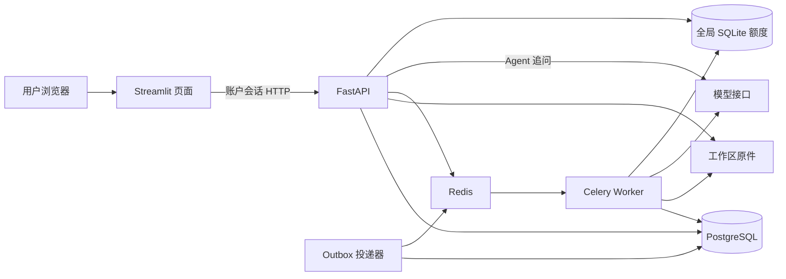

# 阶段四：独立页面、运维与交付

本阶段把用户操作全部接到 HTTP API，补齐依赖就绪检查、结构化事件、完整备份恢复和离线调度基准。模型分析协议与原实验保持原状；不因部署升级重新分析表格。

## 用户流程与服务边界

打开 <http://localhost:8501>，使用已有账户登录，上传 Excel / CSV，选择工作表及评价列，确认后提交后台分析。关闭页面后任务继续；重新登录可从任务和历史中读取进度、可视化报告、原文与对话。追问通过 API 使用服务端保存的报告和只读原表工具；页面不能指定其他人的工作区。



推荐的 `compose.production.yml` 独立启动全部服务。页面容器不挂载业务数据卷、不读取 `.env`，不接收数据库密码、部署者共享 Token 或模型 Key，并使用只读根文件系统。用户登录后的会话 Token 仍暂存于 Streamlit 服务端会话中。API / Worker 持有业务配置，投递器只接收数据库和队列配置。数据库、Redis 不开放宿主端口；默认只暴露本机 8501 / 8000。

`APP_UI_MODE=api` 明确启用接口页面。兼容旧账户部署：仅配置非空 `APP_DATABASE_URL` 时也进入接口页面，只把它当模式标记；接口故障不回退到本地共享历史。未配置上述两项的本地旧版仍可独立运行。旧的四文件 Compose 保留为兼容入口，但只有新推荐配置移除了页面的密钥与数据卷。

## 已有账户部署升级

保留现有 `.env`，保持原 Compose 项目名和工作目录，复用 `usage_data`、`postgres_data`、`redis_data`。更改项目名会创建新卷，不能当作原数据已迁移。

```powershell
docker compose -f compose.production.yml build api
python tools/backup_workspace.py --compose-file compose.production.yml
docker compose -f compose.production.yml up -d --no-build
```

备份默认拒绝待运行、运行中或已发送未确认的任务，维护窗口会短暂停止原运行的页面 / API / Worker / 投递器，结束后恢复原服务。不要删除卷或覆盖 `.env`。Alembic 仍通过独立 `db-init` 执行，启动请求不创建数据库结构。

全新部署先按 README 安装项目依赖并创建 `.env`，填写自己的模型接口，再准备 PostgreSQL 密码、初始化数据库并创建账户。下方 `python` 指已安装依赖的 Python 环境；Windows 可直接替换为 `.\.venv\Scripts\python.exe`。

```powershell
python tools/prepare_account_deployment.py
docker compose -f compose.production.yml build api
docker compose -f compose.production.yml up -d --wait postgres redis
docker compose -f compose.production.yml run --rm --no-deps db-init
docker compose -f compose.production.yml run --rm --no-deps api python -m backend.manage bootstrap --username owner --credentials-file /data/customerinsight/.bootstrap/owner.json
docker compose -f compose.production.yml up -d --no-build
New-Item -ItemType Directory -Force .runtime | Out-Null
docker compose -f compose.production.yml cp api:/data/customerinsight/.bootstrap/owner.json .runtime/owner_credentials.json
```

最后两条为 Windows PowerShell 的凭据取回步骤；Linux 可先 `mkdir -p .runtime` 再执行同一 `docker compose cp`。读取该私密 JSON 中的用户名和初始密码登录，登录后可以改密；旧凭据文件不会随改密更新。管理员自行保管文件，不要提交或分享。已有 SQLite 共享历史需按 [阶段三迁移](API_PHASE3.md)明确指定归属账户导入，不能直接把旧历史视为新账户的数据。已有账户无需重新 bootstrap 或重新导入。

登录页面只接受已创建的账户。填写一个新用户名不会自动注册；初次部署请使用初始凭据文件中的账号。提示“用户名或密码不正确”时，核对用户名及对应密码；提示登录频繁时稍后再试。已有密码被修改后，应使用新密码，不能重新 bootstrap 来重置。

## 健康检查、指标与事件

| 入口 | 含义 |
| --- | --- |
| `GET /healthz` | API 进程存活，正常返回 200；不证明后台任务可用 |
| `GET /readyz` | 检查数据库与迁移版本；队列模式额外检查 Redis、Worker 和投递器的有效心跳，缺少任一项返回 503 |
| `GET /api/v1/operations/metrics` | 需要登录，只汇总当前工作区任务、分组、待投递通知、请求占用与最近最多 1,000 次尝试的 token / 延迟 |

`/readyz` 仅返回状态和布尔检查，不返回地址、用户名、工作区、原文或错误详情，也不调用模型。服务使用 Redis TIME 生成租约，固定角色索引中最多检查 32 个候选，避免扫描整个 Redis。Worker 默认每 5 秒更新、20 秒过期；投递器成功完成一次循环后更新，默认 25 秒过期。容器自身检查验证本容器的租约，旧进程退出不能删除新进程的租约。

这些检查识别进程和依赖可达性，不能代替模型供应商可用性、任务完成期限或业务质量承诺。API 容器自身使用 `/healthz`，以免依赖 Worker 的就绪检查形成启动循环；对外接入方可以使用 `/readyz`。

API、任务、分组断点和投递产生白名单 JSON 事件，带安全请求编号、任务编号、状态、耗时与 token 数。事件不格式化上传单元格、文件名、用户问题、Token、模型响应或异常正文；日志输出故障不会改变业务执行结果。Celery 的失败堆栈也替换为安全错误信息。查看服务日志：

```powershell
docker compose -f compose.production.yml logs --tail 100 api worker dispatcher
```

指标中的每日剩余额度标记为 `deployment`：它仍是部署级 SQLite 限额，不是账户账单。当前没有 Prometheus 抓取端点、Grafana 面板、告警通知或分布式链路追踪。

## 两类备份

页面下载的历史备份只包含当前工作区的历史、原件、字段映射和对话，适合用户导出，不能完整恢复后台服务。

管理员完整备份包含 PostgreSQL 自定义格式 dump、整个 `/data` 文件与 SQLite 一致性快照、逐表 / 序列 / 文件校验清单，涵盖账户、任务断点、原表和旧额度台账。它不复制宿主 `.env`，但包含客户原文、密码哈希、会话记录和数据卷内的初始账户凭据，**ZIP 未加密，必须当作私密备份保管**。工具拒绝放入公共 `outputs` 目录，也不覆盖已有文件。

```powershell
python tools/backup_workspace.py --compose-file compose.production.yml --output .runtime/backups/my-backup.zip
python tools/restore_workspace.py .runtime/backups/my-backup.zip --project customerinsight-restore-rehearsal --app-image customerinsight-backend:phase4 --cleanup
```

恢复工具只允许全新 `customerinsight-restore-*` 项目，拒绝复用或覆盖已有资源。它创建独立 PostgreSQL 17、独立数据卷、无外部访问的网络，不开放端口，不启动 API、Worker 或投递器，不发送模型请求。恢复后逐项核对逻辑内容与文件摘要，再撤销恢复库中的登录会话；未知发送状态保持未知，不自动重跑。`--cleanup` 仅在验证成功后清理本次归属匹配的演练资源；失败资源保留供排查。

这是恢复演练工具，尚未提供覆盖现有线上数据库的一键灾难切换。Redis 消息不作为恢复依据；任务持久化状态和 Outbox 在 PostgreSQL。真正恢复服务前需管理员核对任务状态，明确处理未知调用，不能盲目重投。

## 回归、CI 与性能

[GitHub Actions 配置](../.github/workflows/ci.yml)包括冻结依赖、源码编译、完整离线测试、真实 PG 独立 schema 测试、Docker 构建、双账户真实队列、完整备份恢复及隔离基准。固定无效模型 Key，不需要真实模型凭据。当前目录不是 Git 仓库，尚无远程 Actions 成功记录；本机结果以 [本阶段交付](API_PHASE4_DELIVERY.md)为准。

性能方法、测量起止点、资源约束及复现命令见 [基准说明](BENCHMARK_METHOD.md)。基准使用真实 HTTP / PG / Redis / Celery 和模拟模型，单 Worker；结果只衡量这个实验条件下的后端调度能力，不能代表真实 LLM 的吞吐或线上 SLA。

当前仍为单机共享数据卷部署：原件、全局 SQLite 额度和跨进程文件锁尚未适配多节点；不承诺上游请求恰好收费一次。账户创建仍由管理员执行，没有公开注册、多角色权限或自动数据保留清理。本阶段没有新增真实模型效果评测。
