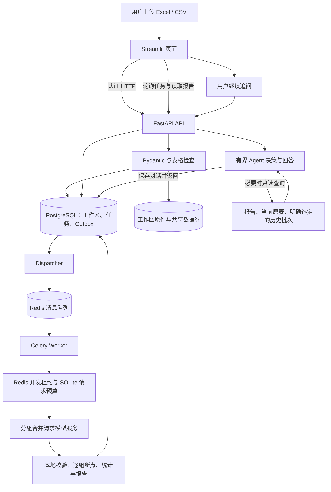

# 当前 Python 后端技术栈与职责

核对日期：2026-10-23。依据当前依赖清单、实际代码、生产部署配置和 CI 工作流整理；描述的是已经使用的技术，不是待实现清单。

项目目前是一个以 Python 为主的单机部署系统：用户在网页上传 Excel / CSV，API 校验并保存任务，后台 Worker 分组合并调用模型，结果持久化后用于统计、可视化、跨批比较和 Agent 追问。网页通过认证 HTTP 使用后端，不直接连接数据库或读取业务数据卷。

## 技术与用途

| 层次 | 已使用技术 | 在项目中的实际作用 |
| --- | --- | --- |
| 开发语言 | Python，声明支持 3.11 及以上；生产镜像使用 Python 3.12 | 实现上传处理、API、任务调度、模型接入、统计、Agent 与运维工具。 |
| HTTP 服务 | FastAPI + Uvicorn | FastAPI 提供登录、上传、任务进度、历史报告、跨批比较、导出和 Agent 接口；Uvicorn 运行 ASGI 应用。生产配置目前为单 Uvicorn 进程。 |
| 输入与输出契约 | Pydantic 2 + python-multipart | 校验接口参数、模型结构化输出和 Agent 工具参数；接收上传的表格文件。模型返回 JSON 后仍需通过本地校验。 |
| 业务数据库 | PostgreSQL 17 | 持久保存账户、工作区、会话、历史报告与对话，以及任务、分组、逐行结果、模型请求尝试和 Outbox 通知等。历史记录不能依赖浏览器会话或 Redis 队列存活。 |
| 数据访问与迁移 | SQLAlchemy 2 + psycopg 3 + Alembic | SQLAlchemy 管理表模型、数据库连接和事务；psycopg 是 PostgreSQL 驱动；Alembic 管理数据库版本，部署时单独执行迁移。实现中混合使用表模型、Core 查询及兼容既有任务状态机的 SQL 适配，不能把它描述为全量 ORM 或全异步数据库访问。 |
| 后台任务 | Celery 5 + Redis 7 | Celery Worker 消费分析任务，避免长时间分析占住网页请求；Redis 作为任务消息 Broker。消息只携带经过校验的任务标识，Celery 未配置 Redis 结果后端，业务结果以数据库为准。独立 Dispatcher 负责把数据库中的待投递通知发往队列。 |
| 共享并发与心跳 | Redis + Lua | 用带过期时间和所有者令牌的租约限制部署范围内的模型并发；发布 Worker / Dispatcher 心跳，供就绪检查使用。Lua 将关键步骤合并为 Redis 原子操作。Redis 在此不只是缓存。 |
| 请求费用保护 | Python 标准库 sqlite3 | 保留部署级每日模型请求计数，在实际发送前通过 SQLite 事务原子预占。当前是共享卷上的全局额度，不是按账号计费，也不是多节点分布式账单系统。 |
| 原始文件与数据卷 | 本地文件系统 + Docker 命名卷 + SHA-256 | 持久原件按服务器确定的工作区目录保存，记录内容摘要用于完整性核对；任务快照也保存在数据库。生产原件和额度库位于共享数据卷，PostgreSQL、Redis 分别使用独立数据卷。 |
| 表格与统计 | Pandas + openpyxl + NumPy | 读取与检查 Excel / CSV、选择工作表和评价列、保留原始行号、处理空值与重复项、计算情感 / 类别 / 优先级等分布并生成导出。Excel 支持普通 .xlsx，旧版 .xls 需另存为 .xlsx。 |
| 模型与 HTTP 客户端 | OpenAI Python SDK + HTTPX | SDK 接入配置的 OpenAI 兼容模型服务，支持代码中明确实现的 Chat Completions / Responses 路径；HTTPX 供网页侧调用本项目后端 API，SDK 自身也基于 HTTPX。某个兼容服务是否支持具体输出模式，仍需实际验收，不能由“兼容”二字推断。 |
| 登录与工作区隔离 | argon2-cffi + 不透明 Bearer 会话 + 数据库约束 | Argon2id 哈希保存密码；登录后签发随机会话令牌，数据库只存令牌哈希，支持过期与撤销。API 从已验证身份选择工作区，业务查询和原件目录据此隔离；不是把客户端传来的工作区 ID 当作权限依据。 |
| 配置 | python-dotenv + 环境变量 | 集中读取模型连接、超时、并发和额度等部署参数。生产页面容器不接收模型 Key、数据库连接或业务数据卷；需要模型的 API / Worker 由部署配置注入。 |
| 网页和图表 | Streamlit + Altair | Streamlit 是表现层，负责上传表格、展示任务进度与报告、对话和下载；Altair 负责交互图表。这两项不能当作 FastAPI、数据库或任务队列的替代品。 |
| 部署与依赖 | Docker + Docker Compose + uv + 锁文件 | Compose 编排页面、API、Worker、Dispatcher、迁移任务、PostgreSQL 和 Redis；Docker 镜像以非 root 用户运行，页面根文件系统只读。uv 和锁文件用于固定依赖与复现环境，镜像依据导出的固定依赖安装。 |
| 测试与持续检查 | unittest + unittest.mock + Streamlit AppTest + GitHub Actions | 测试输入边界、失败隔离、任务恢复、权限、接口和页面；离线测试用 Mock 避免真实模型费用，独立环境另外验证真实数据库 / Redis / Celery / HTTP 流程。Actions 工作流已配置，本地交付记录明确尚未远程执行。 |

## 用户操作在后端如何流转

分组合并表示一次请求可分析多条评价；实际请求数还受文本长度、重复项、失败状态和任务预算影响，不能机械地等同于评价条数。后台分析和 Agent 追问是两种调用流程：分析任务由 Worker 执行；当前 Agent 请求由 API 业务服务执行，并共享模型请求额度与并发约束，没有把所有对话都投递给 Celery。

## 已实现的工程机制

以下是系统设计与业务机制，不是额外安装的技术栈：

- **Outbox 与幂等提交**：创建任务时记录待投递通知；Dispatcher 根据数据库记录投递。幂等键和任务状态检查降低重复提交、重复通知造成的重复分析风险。不能据此宣称外部付费模型具备严格的 exactly-once 调用保证。
- **租约、心跳与断点**：Worker 按分组领取任务并保存已完成结果；租约与状态检查约束过期执行者。连接中断后无法确定模型是否已处理的请求会进入需核对状态，不自动重复付费请求。
- **工作区隔离**：账户对应独立工作区，报告、任务、对话与原件查询按服务端身份限定；当前不是复杂的组织成员、角色和授权管理系统。
- **有界 Agent 工具循环**：模型先结合报告和有限历史对话决定是否继续查询，由 Python 执行白名单只读工具，再由模型写回答。可以获取整体分布、差评与高优先级案例、表格字段和指定原始行，也可读取明确选定的上批原文。当前设置上限为每轮 3 次模型请求、6 次工具调用；工具不执行任意代码、任意 SQL 或外网请求。
- **确定性统计与可追溯引用**：数量和比例由程序计算，输出保留原始行证据；Agent 引用需要校验。引用通过只说明依据标识有效，不能证明自然语言解释一定正确。
- **运行检查与脱敏日志**：提供存活检查、依赖就绪检查以及受认证保护的运行指标；结构化日志采用字段白名单，记录请求编号、状态、耗时和 token 等，不写客户原文、问题、凭据或上游异常正文。当前不是 Prometheus / Grafana / OpenTelemetry 平台，也没有自动告警。
- **备份与恢复演练**：工具在停写窗口导出 PostgreSQL 和数据卷，用摘要核对数据库、SQLite 与原件，再在全新隔离环境验证恢复。不是只有数据库备份，也不是直接自动覆盖线上数据。完整备份未加密且包含敏感业务数据，需私密保存。

## 数据到底存在哪里

| 数据 | 当前生产存储 | 说明 |
| --- | --- | --- |
| 用户、工作区、会话 | PostgreSQL | 会话令牌只保存哈希；密码保存 Argon2id 哈希。 |
| 历史报告、映射与 Agent 对话 | PostgreSQL | 可跨页面刷新和服务重启读取，按工作区限定。 |
| 后台任务、分组结果、请求尝试、Outbox | PostgreSQL | 数据库是业务状态依据；队列通知丢失时可据此恢复安全投递。 |
| 持久上传原件 | 工作区目录中的本地文件 | 通过命名卷持久化，不放在浏览器本地，也没有使用 S3 / MinIO。 |
| 待执行通知、并发租约、服务心跳 | Redis | 不用 Redis 保存正式报告或充当业务任务状态的唯一来源。 |
| 部署级每日请求额度 | SQLite | 计数覆盖真实发送尝试，包括失败；旧版 SQLite 历史实现也保留供兼容和迁移使用。 |

## 面试和简历中的准确表述

可以概括为：**Python + FastAPI + PostgreSQL / SQLAlchemy / Alembic + Redis / Celery + Docker Compose**，并结合实际实现说明“账户隔离、持久化任务、Outbox、幂等和有界模型调用”。Pandas / openpyxl 是表格处理部分，OpenAI 兼容 SDK 是模型接入部分，Streamlit 是网页表现层。

目前没有使用 JWT、OAuth 第三方登录、LangChain、LangGraph、向量数据库、Embedding 检索、RAG 框架、对象存储、Kubernetes 或 Nginx。Agent 的原文检索是受限的本地表格查询，不应写成已经建设了向量 RAG 平台。当前账户由部署者创建，尚无网页自助注册。

部署仍为单机共享卷架构：具备独立 API 与后台进程，不代表已实现多节点高可用、分布式文件存储、多租户计费或完善的生产告警。模型效果实验与模拟模型性能实验应分别陈述，不能把 Mock 调度吞吐写成真实 LLM 处理能力。

## 核对代码

- [依赖清单](../pyproject.toml)、[生产编排](../compose.production.yml)、[镜像定义](../Dockerfile)、[CI 工作流](../.github/workflows/ci.yml)。
- [API 与认证入口](../backend/app.py)、[账户会话](../backend/accounts.py)、[工作区服务](../backend/tenancy.py)、[数据库连接](../backend/database.py)。
- [PostgreSQL 历史仓库](../backend/pg_history.py)、[PostgreSQL 任务仓库](../backend/pg_jobs.py)、[Worker](../backend/job_worker.py)、[Celery 配置](../backend/celery_app.py)、[通知投递与 Redis 租约](../backend/dispatch.py)。
- [模型客户端](../ai/client.py)、[合并分析](../ai/grouped_batch.py)、[额度与调用控制](../core/product_service.py)、[Agent](../core/analysis_agent.py)、[原表查询工具](../core/agent_table_tools.py)。
- [就绪与运行指标](../backend/operations.py)、[结构化日志](../backend/observability.py)、[备份校验](../backend/backup.py)、[阶段四验证记录](API_PHASE4_DELIVERY.md)。
